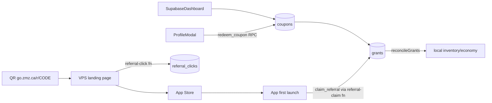

# Coupons and QR Referrals — Implementation Plan

*Status: planned, not started.* Written so a lower-cost model can build it step by step. Main product blueprint: [`ZIKARON3D_BLUEPRINT.md`](ZIKARON3D_BLUEPRINT.md).

## Overview

Server-validated coupon codes (managed for free in the Supabase dashboard) and unlimited per-user QR referral codes that auto-credit both players, using Supabase (RPCs + Edge Functions), a self-hosted referral landing page on the new VPS, and a shared server grant ledger applied to the local inventory.

## Decisions (locked)

- **Coupon admin**: Supabase Dashboard (free tier, already used). Table Editor = enable/disable/expire/edit; SQL Editor = bulk generate via `admin_generate_coupons(...)`. No extra install.
- **Referral**: fully automatic. QR -> `https://go.zmz.ca/r/<CODE>` landing page on deepflow-vps -> App Store. On first launch the app claims via (1) universal link, (2) server IP match, (3) iOS paste button fallback. Silent Supabase anonymous account for anyone not signed in.
- **Single reward path**: every reward (coupon or referral) is a row in a server `grants` ledger; the client applies unseen rows to local stores (same pattern as `reconcilePurchases()` in `src/services/monetization.ts`).
- Placeholder domain `go.zmz.ca` (owner creates DNS A record in Cloudflare dashboard to 77.42.114.57, DNS-only/grey cloud so Let's Encrypt + AASA work).

## Asset types (a "game asset")

`asset_type` enum: `skin | accessory | crystals | stardust | shields`. `asset_id` = catalog id for skin/accessory (from `src/data/shopCatalog.ts` `SKIN_CATALOG`/`ACCESSORY_CATALOG`), currency name for currencies; `amount` for currencies (1 for items). Client apply map:

- skin -> `useInventory.getState().addSkin(id)`
- accessory -> `useInventory.getState().addAccessory(id)`
- crystals -> `useEconomy.getState().earnCrystals(n, false)`
- stardust -> `useEconomy.getState().earnStardust(n)`
- shields -> `useProfile.getState().addShields(n)`

## Step 1 — Database: append to `supabase/schema.sql` (re-runnable)

Tables (all `create table if not exists`, RLS enabled):

- `game_assets(id text pk, asset_type text check in (...), name text)` — seeded from catalog; read all for `authenticated`. Coupons FK to it so the dashboard shows a picker and typos are impossible. Insert rows `('crystals','crystals'),('stardust','stardust'),('shields','shields')` for currencies.
- `coupons(code text pk check (code ~ '^[A-Z0-9]{6,16}$'), asset_id text not null references game_assets, amount int not null default 1 check (amount between 1 and 100000), active bool not null default true, starts_at timestamptz default now(), expires_at timestamptz null, max_redemptions int null, redemption_count int not null default 0, batch text, note text, created_at timestamptz default now())`. **No client policies** (clients only use the RPC).
- `coupon_redemptions(code text references coupons on delete cascade, user_id uuid references auth.users on delete cascade, created_at, primary key(code,user_id))`.
- `coupon_attempts(user_id uuid, created_at timestamptz default now())` + index — failed-attempt throttle.
- `referral_codes(code text pk, owner_id uuid references auth.users on delete cascade, created_at, disabled bool default false)` + index on owner_id. Policy: select own.
- `referral_clicks(id bigserial pk, code text references referral_codes on delete cascade, ip_hash text, platform text, created_at, claimed_by uuid null)`. No client policies.
- `referrals(referee_id uuid pk references auth.users on delete cascade, referrer_id uuid references auth.users on delete cascade, code text, created_at)` — pk on referee = a user can be referred only once. Policy: select where `referrer_id = auth.uid() or referee_id = auth.uid()`.
- `reward_config(key text pk, asset_id text references game_assets, amount int)` — rows `referral_referrer`, `referral_referee` (editable in dashboard). Seed e.g. referrer = `crystals` 50, referee = a common skin.
- `grants(id bigserial pk, user_id uuid references auth.users on delete cascade, source text check in ('coupon','referral_referrer','referral_referee'), source_ref text, asset_type text, asset_id text, amount int, created_at)`, unique `(user_id, source, source_ref)`. Policy: select own.

Functions (all `security definer`, `set search_path = public`, `revoke all from public, anon; grant execute to authenticated` except admin ones which get **no** grants -> only dashboard/service role):

- `redeem_coupon(p_code text) returns json`:
  1. `auth.uid()` required; normalize `upper(trim(p_code))`.
  2. If >=10 rows in `coupon_attempts` for user in last hour -> `{ok:false, reason:'throttled'}`.
  3. `select ... for update` the coupon. Fail reasons: `not_found`, `inactive`, `not_started`, `expired` (`expires_at <= now()`), `used_up` (`max_redemptions` reached), `already_redeemed`. On fail insert into `coupon_attempts` and return reason.
  4. Insert `coupon_redemptions`, increment `redemption_count`, insert `grants(source='coupon', source_ref=code, ...)` joined with `game_assets` for `asset_type`.
  5. Return `{ok:true, asset_type, asset_id, amount}`.
- `admin_generate_coupons(p_asset_id text, p_count int, p_amount int default 1, p_expires_at timestamptz default null, p_max_redemptions int default 1, p_batch text default null, p_prefix text default '') returns setof text` — random codes from alphabet `ABCDEFGHJKLMNPQRSTUVWXYZ23456789` (no 0/O/1/I), length 8 after prefix, retry on conflict. Also `admin_set_batch_active(p_batch text, p_active bool)` and `admin_expire_batch(p_batch text)`.
- `create_referral_code() returns text` — 7-char code same alphabet, insert for `auth.uid()`, unlimited per user. Rate guard: max 50 per user per day (anti-spam only).
- `claim_referral(p_code text, p_referee uuid) returns json` — **not granted to authenticated**; called only by the Edge Function with service role. Checks: code exists and not disabled; owner != referee; referee has no `referrals` row; referee `auth.users.created_at > now() - interval '48 hours'`. Insert `referrals`, insert two `grants` rows (`referral_referee` source_ref=referrer id, `referral_referrer` source_ref=referee id) using `reward_config`. Returns `{ok, reason?}`.
- `delete_my_account` needs no change (cascades cover new tables).

## Step 2 — Seed script for `game_assets`

New `scripts/admin/genAssetSeed.ts` (run with `npx tsx`): imports `SKIN_CATALOG`, `ACCESSORY_CATALOG`, writes `insert into game_assets ... on conflict (id) do update set name = excluded.name;` to `supabase/seed_assets.sql`. Re-run whenever the catalog changes; paste into SQL Editor.

## Step 3 — Edge Functions (`supabase/functions/`, mirror style of `revenuecat-webhook/index.ts`)

- `referral-click` (`verify_jwt = false`): POST `{code, platform}` from the landing page. Validate code regex `^[A-Z2-9]{7}$` and existence; hash client IP (`x-forwarded-for` first entry) as `sha256(ip + REFERRAL_IP_SALT)`; insert `referral_clicks`; delete clicks older than 7 days. CORS allow `https://go.zmz.ca` only. Return 204.
- `referral-claim` (`verify_jwt = true`): body `{code?: string}`. Resolve user from JWT (`supabase.auth.getUser(token)`). If `code` missing: find most recent unclaimed `referral_clicks` with same `ip_hash` within 2 hours; if none -> `{ok:false, reason:'no_match'}`. Call `claim_referral` via service-role client; mark click `claimed_by`. Return result.
- Add both to `supabase/config.toml` with comments; secret `REFERRAL_IP_SALT` via `supabase secrets set`.

## Step 4 — Client: auth + grants service

- Enable **Anonymous sign-ins** in Supabase Dashboard > Authentication > Providers (manual step).
- `src/services/supabase.ts`: add `ensureSession(): Promise<string | null>` — returns current `userId` or calls `supabase.auth.signInAnonymously()`. Verify the API in installed `@supabase/supabase-js` typings before use. In `signInWithApple`, if current user `is_anonymous`, try `supabase.auth.linkIdentity` with the Apple id token if the installed version supports id-token linking; otherwise keep current behavior (local inventory already holds granted items).
- New `src/services/grants.ts`:
  - `reconcileGrants(): Promise<GrantRow[]>` — select own `grants`, skip ids in MMKV set `zikaron3d-grants:applied`, apply via the map above, remember id, return newly applied rows (for celebration UI).
  - `redeemCoupon(code): Promise<RedeemResult>` — `ensureSession()`, `supabase.rpc('redeem_coupon', {p_code})`, then `reconcileGrants()`.
  - Call `reconcileGrants()` inside `syncUser` in `src/services/sync.ts` after `reconcilePurchases()`, and on app foreground (AppState `active`) so referrers get credited when the friend joins.
- New `src/services/referral.ts`:
  - `createReferralCode()` -> `ensureSession()` + RPC; `listMyReferralCodes()`; `myReferralCount()` (count `referrals` where referrer = me).
  - `referralUrl(code)` = `${process.env.EXPO_PUBLIC_REFERRAL_HOST ?? 'https://go.zmz.ca'}/r/${code}`.
  - `tryClaimOnFirstLaunch()` — runs once (flag in Keychain via `expo-secure-store` key `zikaron3d.referral.done`, survives reinstall = anti-abuse): (1) initial URL from `expo-linking` matching `/r/([A-Z2-9]{7})`; (2) else call `referral-claim` with no code (IP match). On `ok` or definitive reason (`already_referred`, `self`, `too_old`) set the flag. On `no_match` set `pendingPaste` state for the fallback UI (only within first 2 launches).
  - Also handle URLs while running (`Linking.addEventListener('url')`): if not yet claimed, claim with that code.

## Step 5 — Native config + packages

- `npx expo install expo-linking expo-clipboard react-native-qrcode-svg` (qrcode-svg is pure JS on the already-installed `react-native-svg`). Verify each against SDK 58 docs.
- `app.json`: add `"scheme": "zikaron3d"`, `ios.associatedDomains: ["applinks:go.zmz.ca"]`. Rebuild native (`npx expo run:ios`); never edit `ios/` by hand. Ensure Associated Domains capability exists on the App ID in the Apple Developer portal.
- `.env`: `EXPO_PUBLIC_REFERRAL_HOST=https://go.zmz.ca`, `EXPO_PUBLIC_APP_STORE_URL=https://apps.apple.com/app/id<APP_ID>`.

## Step 6 — UI

- `src/ui/ProfileModal.tsx`: add a "GIFTS" section below the wardrobe with two big buttons: **Redeem code** and **Invite friends** (lucide `Gift`, `QrCode` icons, existing sfx/haptics patterns).
- New `src/ui/RedeemCodeModal.tsx`: single `TextInput` (autoCapitalize characters, max 16, strips spaces), submit button with loading state. Map reasons to short friendly messages. On success show reward reveal (asset image from `src/data/shopAssets.ts` `getSkinImage`/`ACCESSORY_ASSETS`, or crystal/stardust/shield icon) with `sfx.play('chime')` + `sfx.play('sparkle')` + success haptic and an "Equip" shortcut for items.
- New `src/ui/InviteModal.tsx`: on open, if user has no code call `createReferralCode()`; render `<QRCode value={referralUrl(code)} size={220} />` on white rounded backing, "New code" button (creates another, unlimited), "Share" button using RN `Share.share({ message, url })`, friends-joined counter from `myReferralCount()`, and the reward preview from `reward_config`.
- New `src/ui/FriendGiftBubble.tsx` (shown from `App.tsx` when `pendingPaste`): "Got a gift link from a friend?" + `ClipboardPasteButton` from `expo-clipboard` (iOS 16+, no paste permission prompt); parse `/r/CODE` or bare code, call claim; dismissible, never shown again after dismiss.
- `App.tsx`: on mount after `initAuth()`, call `tryClaimOnFirstLaunch()`; when grants are newly applied, show the same reward reveal.

## Step 7 — VPS landing page (deepflow-vps, `ssh deepflow-vps`)

Files in repo under new `public-site/referral/`:

- `index.html` — served for `/r/*`: kid-friendly page (logo, mascot, "Your friend sent you a gift!"), big "Get Zikaron3D" button. JS: parse code from path; on load `fetch(SUPABASE_URL/functions/v1/referral-click, {code, platform})`; on button tap `navigator.clipboard.writeText(location.href)` (user gesture) then `location.href = APP_STORE_URL`. Android/desktop: show App Store link + QR only.
- `.well-known/apple-app-site-association` (no extension, `Content-Type: application/json`):
  `{"applinks":{"details":[{"appIDs":["DAVRE4G59N.com.AdvBig.Zikaron3D"],"components":[{"/":"/r/*"}]}]}}`
- `nginx-go.zmz.ca.conf` — server block: root `/var/www/zikaron3d-go`, `location ^~ /r/ { try_files /index.html =404; }`, AASA location with JSON content type, security headers as in `public-site/Caddyfile`.
- Deploy: back up `/etc/nginx` first, copy conf to `/etc/nginx/sites-available/` + symlink, `sudo nginx -t`, reload, `certbot --nginx -d go.zmz.ca`. Do not touch outagepulse/k3s configs. Add `scripts/deploy/deploy-referral.sh` (rsync to `deepflow-vps:/var/www/zikaron3d-go`).

## Step 8 — Admin how-to (Supabase SQL Editor / Table Editor)

- Generate: `select * from admin_generate_coupons('pip_chrome', 100, 1, '2027-01-31', 1, 'xmas26', 'XMAS');`
- Disable/enable: Table Editor > `coupons` > toggle `active`, or `select admin_set_batch_active('xmas26', false);`
- Expire: edit `expires_at`, or `select admin_expire_batch('xmas26');`
- Single public code (many users): `max_redemptions = null`.
- Stats: `select batch, count(*), sum(redemption_count) from coupons group by batch;`
- Change referral rewards: edit `reward_config`.
- Manual setup checklist: enable anonymous sign-ins, DNS `go.zmz.ca`, Associated Domains capability, function deploys + `REFERRAL_IP_SALT` secret.

## Step 9 — Compliance

- Update `public-site/privacy.html`: anonymous account id, hashed IP for referral attribution (deleted after 7 days), no personal data in QR.
- App Store 3.1.1 risk: codes must be **free giveaways only**, never sold; all coupon assets must also be obtainable in-app.

## Step 10 — Verification

- SQL tests in SQL Editor: redeem valid / inactive / expired / used_up / twice / throttled; claim self-referral / second referral / old account.
- Simulator: redeem flow end-to-end, QR renders and scans to correct URL, universal link opens app with code (`xcrun simctl openurl booted https://go.zmz.ca/r/ABCDEFG`), referrer sees grant after foreground.
- `curl -sI https://go.zmz.ca/.well-known/apple-app-site-association` -> 200 JSON.
- `npx expo lint` and `npx tsc --noEmit` pass.

## Build checklist (for implementer)

| Step | Area | Done |
|------|------|------|
| 1 | `supabase/schema.sql` tables + RPCs | |
| 2 | `scripts/admin/genAssetSeed.ts` + `seed_assets.sql` | |
| 3 | Edge Functions `referral-click`, `referral-claim` | |
| 4 | `grants.ts`, `referral.ts`, `supabase.ts` session | |
| 5 | Expo packages + `app.json` links | |
| 6 | Profile GIFTS UI + modals | |
| 7 | VPS landing + deploy script | |
| 8 | Supabase dashboard setup | |
| 9 | `privacy.html` | |
| 10 | Tests + lint/typecheck | |