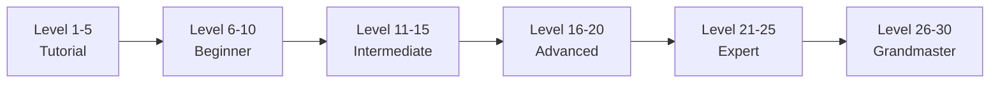
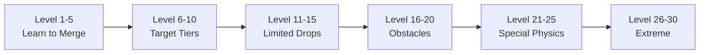
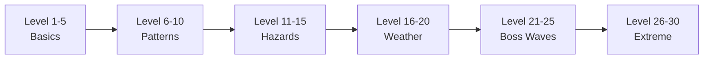

# Zikaron3D — Next Level Plan: Monetization, Engagement & 30-Level Difficulty

> [!IMPORTANT]
> This plan builds on top of the existing v2 arcade platform. No existing gameplay is removed — everything here is additive. The game targets **all ages** (kids, gamers, seniors), so monetization must remain **ethical** and pass Apple's Kids Category review.

---

## Table of Contents
1. [Economy & Currency System](#1-economy--currency-system)
2. [The Shop](#2-the-shop)
3. [Cosmetics & Accessories](#3-cosmetics--accessories)
4. [Character Expansion & Rarity](#4-character-expansion--rarity)
5. [Season Pass (Adventure Pass)](#5-season-pass-adventure-pass)
6. [Engagement & Exclusivity Loops](#6-engagement--exclusivity-loops)
7. [30-Level Difficulty Scaling — Critter Burrows](#7-30-level-difficulty-scaling--critter-burrows)
8. [30-Level Difficulty Scaling — Orb Merge](#8-30-level-difficulty-scaling--orb-merge)
9. [30-Level Difficulty Scaling — Star Catcher](#9-30-level-difficulty-scaling--star-catcher)
10. [New Worlds & Unlocks](#10-new-worlds--unlocks)
11. [Implementation Phases](#11-implementation-phases)
12. [Architecture & File Map](#12-architecture--file-map)

---

## 1. Economy & Currency System

### Current State
- ❌ No currency — only 1 consumable IAP (`shield_pack_10`)
- ❌ No shop screen — purchase buried in Settings
- ❌ No way to earn premium items through gameplay

### New Dual-Currency System

| Currency | Name | Icon | How to Earn | How to Buy |
|----------|------|------|-------------|------------|
| **Soft** | ⭐ **Stardust** | Glowing star particle | Every game: 1–5 per round based on performance. Daily bonus: 25. Weekly streak: 100. Level up: 50. | Cannot be bought (pure gameplay) |
| **Hard** | 💎 **Crystals** | Spinning gem | Rare drops from Fever mode (1–3). Daily challenge completion: 5. Achievement milestones: 10–50. Season pass free tier. | IAP packs: 100/\$0.99, 500/\$3.99, 1200/\$7.99, 3000/\$14.99 |

### Stardust Earn Rates (per game round)

| Performance | Burrows | Orb Merge | Star Catcher |
|-------------|---------|-----------|--------------|
| Poor (< 30 PSR) | 1 | 1 | 1 |
| Average (30–60 PSR) | 2 | 2 | 2 |
| Good (60–80 PSR) | 3 | 3 | 3 |
| Excellent (> 80 PSR) | 4 | 4 | 4 |
| Perfect round / Fever | 5 | 5 | 5 |

### Crystal Drop Table (Rare — excitement moments)

| Event | Crystal Drop | Chance |
|-------|-------------|--------|
| Enter Fever mode (Star Catcher) | 1–3 | 100% on first Fever per run, 30% subsequent |
| Perfect Burrows round (0 mistakes) | 1–2 | 50% at level 10+, 100% at level 20+ |
| Merge to Pip tier (Orb Merge) | 2–5 | 100% |
| Complete daily challenge (all 3 games) | 5 | 100% |
| Weekly login streak (7 days) | 15 | 100% |
| Achievement milestones | 10–50 | One-time |

> [!NOTE]
> Crystals are earnable through gameplay so non-paying players can still unlock premium content — it just takes longer. This is critical for Kids Category compliance and player goodwill.

---

## 2. The Shop

### New Screen: `src/scenes/Shop.tsx`
Accessed from a **shopping bag icon** on the hub's top bar (next to collection star and settings gear).

### Shop Layout (4 Tabs — Icon-Only)

```
┌─────────────────────────────────────┐
│  🎨 Skins  │  🎩 Accessories  │  🌍 Worlds  │  💎 Crystals  │
├─────────────────────────────────────┤
│                                     │
│   Scrollable grid of items          │
│   Each card shows:                  │
│   - Animated preview                │
│   - Rarity glow border              │
│   - Price (⭐ or 💎)                │
│   - "NEW" / "LIMITED" / "OWNED"     │
│                                     │
└─────────────────────────────────────┘
```

### Shop Inventory Categories

| Tab | What's Sold | Price Range (⭐) | Price Range (💎) |
|-----|-------------|------------------|------------------|
| 🎨 Skins | Alternate creature appearances | 200–800 ⭐ | 50–200 💎 |
| 🎩 Accessories | Hats, trails, auras, expressions | 100–500 ⭐ | 25–150 💎 |
| 🌍 Worlds | New themed worlds (gameplay arenas) | — | 300–500 💎 |
| 💎 Crystals | Crystal IAP packs + shield packs | — | Real money |

### IAP Products (via RevenueCat)

| Product ID | Contents | Price | Type |
|------------|----------|-------|------|
| `crystal_100` | 100 💎 | \$0.99 | Consumable |
| `crystal_500` | 500 💎 + 1 random Rare skin | \$3.99 | Consumable |
| `crystal_1200` | 1,200 💎 + 1 Rare + 1 Epic skin | \$7.99 | Consumable |
| `crystal_3000` | 3,000 💎 + 2 Epic skins | \$14.99 | Consumable |
| `shield_pack_10` | 10 streak shields | \$0.99 | Consumable (existing) |
| `adventure_pass` | Season Pass (see §5) | \$4.99 | Non-renewing subscription |
| `starter_bundle` | 500 💎 + 3 Rare skins + 10 shields | \$2.99 | Non-consumable (one-time) |

---

## 3. Cosmetics & Accessories

### 3.1 Creature Skins (Alternate Appearances)

Each creature can have **alternate skins** — same silhouette & animation set, different color palette / texture / effects. Skins are generated via PixVerse with modified prompts (same reference pose, different materials).

| Rarity | Border Glow | Drop Rate | Typical Price | Visual Change |
|--------|-------------|-----------|---------------|---------------|
| **Common** | White | Stardust shop | 200 ⭐ | Recolor (palette swap) |
| **Rare** | Blue | Crystal shop / drops | 50–100 💎 | New material (metallic, glass, plush) |
| **Epic** | Purple | Crystal shop / season pass | 100–200 💎 | Particle trail + material + glow |
| **Legendary** | Gold animated | Season pass exclusive / achievements | Not sold | Full rework + unique idle animation + aura |

### Skin Examples (MVP — 36 skins across 9 creatures)

| Creature | Common Skins (2 each) | Rare Skin | Epic Skin |
|----------|----------------------|-----------|-----------|
| Pip | Snow Pip, Sunset Pip | Chrome Pip | Starfire Pip ✨ |
| Bloop | Lime Bloop, Rose Bloop | Crystal Bloop | Nebula Bloop 🌌 |
| Fuzz | Mint Fuzz, Gold Fuzz | Velvet Fuzz | Aurora Fuzz 🌈 |
| Nutty | Red Nutty, Silver Nutty | Bronze Nutty | Diamond Nutty 💎 |
| Zap | Green Zap, Purple Zap | Neon Zap | Lightning Zap ⚡ |
| Grumble | Teal Grumble, Rust Grumble | Obsidian Grumble | Volcanic Grumble 🌋 |
| Frost | Pink Frost, Black Frost | Sapphire Frost | Blizzard Frost ❄️ |
| Ember | Blue Ember, White Ember | Ruby Ember | Inferno Ember 🔥 |
| Dusk | Dawn Dusk, Void Dusk | Moonstone Dusk | Eclipse Dusk 🌑 |

### 3.2 Accessories (Equippable on Any Owned Creature)

Accessories are **overlays** rendered on top of the creature sprite in the hub, collection, and during gameplay.

| Category | Examples | Slots |
|----------|---------|-------|
| **Hats** | Crown, Top Hat, Pirate Hat, Flower Crown, Cat Ears, Viking Helmet, Wizard Hat, Party Hat | Head |
| **Trails** | Sparkle Trail, Rainbow Trail, Fire Trail, Snow Trail, Heart Trail, Star Trail | Behind |
| **Auras** | Golden Glow, Ice Crystals, Floating Hearts, Musical Notes, Fireflies, Storm Clouds | Around |
| **Expressions** | Sunglasses, Blush Cheeks, Angry Eyebrows, Sleepy Eyes, Heart Eyes | Face |

**Total accessories target:** 40+ items across 4 categories

### 3.3 Hub Customization

| Item | Description | Price |
|------|-------------|-------|
| Hub Themes | Alternate background gradients + particle colors for the hub | 300 ⭐ each |
| Portal Frames | Decorative ring around world portals (flame ring, ice ring, flower ring) | 150 💎 each |
| Pip Outfits | Special hub mascot costumes (changes Pip's idle in hub only) | 200 💎 each |

---

## 4. Character Expansion & Rarity

### Current: 9 Creatures (all equal, no rarity)

### New Rarity Tiers for Characters

| Rarity | Count (at launch) | How to Get | Visual Distinction |
|--------|-------------------|------------|-------------------|
| **Starter** | 3 (Pip, Bloop, Fuzz) | Free from start | Standard glow |
| **Common** | 3 (Nutty, Zap, Grumble) | Unlock via gameplay (world unlocks) | Soft shimmer |
| **Rare** | 3 (Frost, Ember, Dusk) | Unlock via gameplay (higher levels) | Blue sparkle border |
| **Epic** | 4 (NEW creatures) | Crystal purchase / Season Pass / high achievements | Purple animated border |
| **Legendary** | 2 (NEW creatures) | Season Pass Rank 30 / Achievement grandmaster | Gold particles + unique idle |

### New Epic Creatures (4)

| ID | Name | Color | Theme | World | Unlock |
|----|------|-------|-------|-------|--------|
| `coral` | Coral | #FF7F9F (coral pink) | Sea creature, bubbly, translucent | Deep Sea (new world) | 300 💎 or Season Pass Rank 15 |
| `moss` | Moss | #7FBF5F (forest green) | Forest spirit, leafy, grows flowers | Enchanted Grove (new world) | 300 💎 or Season Pass Rank 20 |
| `bolt` | Bolt | #FFB833 (electric amber) | Robot creature, sparks, mechanical idle | Neon Circuit (new world) | 300 💎 or Season Pass Rank 25 |
| `luna` | Luna | #C7A8FF (lavender) | Moth/fairy, glowing wings, floaty | Starlight Summit (new world) | Reach Burrows Level 25 |

### New Legendary Creatures (2)

| ID | Name | Color | Theme | Unlock |
|----|------|-------|-------|--------|
| `nova` | Nova | Rainbow gradient | Cosmic entity, prismatic, morphing colors | Season Pass Rank 30 (exclusive) |
| `titan` | Titan | #D4AF37 (gold) | Giant ancient creature, golden armor | Grandmaster achievement (all 3 games at Level 30) |

> [!TIP]
> Legendary creatures are **extremely rare** and visible to other players on the leaderboard. This drives aspiration and engagement. Players see "Titan" or "Nova" on the top of leaderboards and want to earn them.

---

## 5. Season Pass (Adventure Pass)

### Structure: 30 Ranks, 8-Week Duration

| Feature | Free Track | Premium Track (\$4.99) |
|---------|------------|----------------------|
| Stardust rewards | ✅ Every rank | ✅ Every rank (2×) |
| Crystal rewards | ✅ Ranks 5, 10, 15, 20, 25, 30 | ✅ Every 2 ranks |
| Common skins | ✅ Ranks 3, 9, 18 | ✅ Additional at 6, 12, 21 |
| Rare skins | ❌ | ✅ Ranks 8, 16, 24 |
| Epic skins | ❌ | ✅ Ranks 14, 22, 28 |
| Legendary skin | ❌ | ✅ Rank 30 (season-exclusive, never returns) |
| Epic creatures | ❌ | ✅ Ranks 15, 20, 25 |
| Legendary creature | ❌ | ✅ Rank 30 (Nova — season 1 exclusive) |
| Exclusive accessories | ❌ | ✅ Every 3 ranks (10 total) |
| Hub themes | ❌ | ✅ Ranks 10, 20 |

### Season XP (how to progress ranks)
- Play any game round: 10–30 Season XP (based on performance)
- Daily challenge complete: 100 Season XP
- Weekly missions (3 per week): 150 Season XP each
- Level up: 200 Season XP
- XP needed per rank: `100 + rank × 20` (Rank 1 = 120, Rank 30 = 700)
- Total to complete: ~12,300 Season XP over 8 weeks ≈ ~220/day

### Weekly Missions (Examples)
- "Win 5 Burrows rounds" 
- "Reach Fever 3 times in Star Catcher"
- "Merge to Frost tier in Orb Merge"
- "Play all 3 games today"
- "Earn 50 Stardust"
- "Use 0 shields in an Arcade run"

> [!WARNING]
> For Kids Category compliance: the Season Pass must not use countdown timers that pressure children. Instead, show progress as a **journey map** (a winding path through a landscape). Past seasons' exclusive items become **achievement unlocks** after 2 seasons (delayed, not gone forever).

---

## 6. Engagement & Exclusivity Loops

### 6.1 Daily Login Streak

| Day | Reward |
|-----|--------|
| 1 | 10 ⭐ |
| 2 | 15 ⭐ |
| 3 | 20 ⭐ |
| 4 | 25 ⭐ |
| 5 | 30 ⭐ + 1 Shield |
| 6 | 40 ⭐ |
| 7 | 50 ⭐ + 5 💎 + Random Accessory |
| 14 | 100 ⭐ + 10 💎 + Rare Accessory |
| 30 | 200 ⭐ + 25 💎 + Exclusive "Loyal" Aura |

### 6.2 Achievement System (60+ Achievements)

Achievements unlock **unique** rewards no one else can buy.

**Per-Game Achievements (10 each = 30 total):**

| Achievement | Condition | Reward |
|-------------|-----------|--------|
| First Steps | Complete Level 1 | 10 ⭐ |
| Getting Warmer | Reach Level 5 | 25 ⭐ |
| Sharp Memory | Reach Level 10 | 50 ⭐ + "Memory Master" hat |
| Eagle Eye | Reach Level 15 | 100 ⭐ + 10 💎 |
| Unforgettable | Reach Level 20 | "Crystal Mind" aura (exclusive) |
| Legendary Mind | Reach Level 25 | 200 ⭐ + 25 💎 |
| Grandmaster | Reach Level 30 | "Grandmaster Crown" (exclusive) |
| Speed Demon | Complete under time limit 10× | "Lightning" trail |
| Perfectionist | 5 perfect rounds (0 mistakes) | 50 💎 |
| Marathon | Play 100 rounds total | "Veteran" expression |

**Global Achievements (30 more):**

| Achievement | Condition | Reward |
|-------------|-----------|--------|
| Collector | Own all 9 base creatures | "Collector" aura |
| Full Wardrobe | Own 10 skins | 100 💎 |
| Fashionista | Own 20 accessories | "Fashion Star" trail |
| World Traveler | Unlock all worlds | Exclusive hub theme |
| Social Butterfly | Appear on leaderboard top 10 | "Champion" crown |
| Daily Devotee | 30-day login streak | "Loyal" legendary aura |
| Season Veteran | Complete a Season Pass | Season-specific legendary skin |
| Titan Master | All 3 games at Level 30 | **Titan** legendary creature |
| Stardust Millionaire | Earn 1,000,000 ⭐ lifetime | "Golden" everything skin set |
| Crystal Collector | Earn 1,000 💎 through gameplay | "Diamond" particle trail |

### 6.3 Exclusivity & "Others Don't Have This" Mechanics

| Mechanic | How It Works | FOMO Driver |
|----------|-------------|-------------|
| **Season-Exclusive Skins** | Each 8-week season has 1 Legendary skin only earnable during that season | "I was there" bragging rights |
| **Achievement-Only Items** | Grandmaster Crown, Titan creature — cannot be bought at any price | Skill-based exclusivity |
| **Weekly Rotating Shop** | 4 items rotate every Monday (2 Common, 1 Rare, 1 Epic). Missed = wait for rotation | Check the shop regularly |
| **First-Clear Bonuses** | First time beating each level gives 3× Stardust + Crystal chance | Push to try new levels |
| **Leaderboard Flair** | Top 10 weekly players get a special animated border on their avatar visible to all | Competitive drive |
| **Creature Showcase** | Your equipped skin + accessories show on the leaderboard next to your score | Show off unique combos |
| **Limited-Time Events** | Holiday creatures (Halloween Pip, Winter Frost, etc.) available for 2 weeks only | Seasonal urgency |
| **Prestige System** | After Level 30, prestige resets level to 1 with a permanent star badge (up to ★★★★★) | "I'm prestige 3" flex |

### 6.4 Player Identity & Profile

```
┌────────────────────────────┐
│  [Avatar Ring]  ★★★        │  ← Prestige stars
│  Level 27                  │
│  Equipped: Chrome Pip      │  ← Shows your rarest skin
│           + Crown + Fire   │  ← Accessories equipped
│  Title: "Grandmaster"      │  ← Achievement-based title
│  Achievements: 42/60       │
│  Season Rank: 24/30        │
└────────────────────────────┘
```
This profile card appears on the leaderboard — other players see your equipped items.

---

## 7. 30-Level Difficulty Scaling — Critter Burrows

### Current: 7 levels (3–6 pairs, limited parameter range)

### New: 30 Levels with 6 Scaling Dimensions



| Level | Pairs | Preview (ms) | Hide Delay (ms) | Time Limit (s) | Special Mechanic | Board Layout |
|-------|-------|-------------|-----------------|----------------|------------------|-------------|
| 1 | 3 | 3000 | 1500 | — | None | 2×3 |
| 2 | 3 | 2800 | 1400 | — | None | 2×3 |
| 3 | 3 | 2500 | 1300 | — | None | 2×3 |
| 4 | 4 | 2400 | 1200 | — | None | 2×4 |
| 5 | 4 | 2200 | 1100 | — | None | 2×4 |
| 6 | 4 | 2000 | 1000 | 45 | Timer starts | 2×4 |
| 7 | 5 | 1900 | 1000 | 42 | None | 2×5 |
| 8 | 5 | 1800 | 900 | 40 | **Decoy burrow** (empty, wastes time) | 2×5 + 1 decoy |
| 9 | 5 | 1700 | 850 | 38 | Decoy burrow | 2×5 + 1 decoy |
| 10 | 6 | 1600 | 800 | 36 | None | 3×4 |
| 11 | 6 | 1500 | 750 | 34 | **Burrows shuffle** positions after preview | 3×4 |
| 12 | 6 | 1400 | 700 | 32 | Shuffle + 1 decoy | 3×4 + 1 decoy |
| 13 | 7 | 1300 | 700 | 30 | Shuffle | 3×5 (−1) |
| 14 | 7 | 1200 | 650 | 28 | **2 decoys** | 3×5 + 1 empty row |
| 15 | 7 | 1100 | 600 | 26 | Shuffle + 2 decoys | 3×6 (−4) |
| 16 | 8 | 1100 | 600 | 28 | **Shadow creatures** (dark silhouettes, match by shape only) | 4×4 |
| 17 | 8 | 1000 | 550 | 26 | Shadow + shuffle | 4×4 |
| 18 | 8 | 1000 | 500 | 25 | Shadow + 2 decoys | 4×4 + 2 decoy |
| 19 | 9 | 950 | 500 | 26 | **Triple match** (find 3 of a kind) | 3×6 |
| 20 | 9 | 900 | 450 | 24 | Triple match + shuffle | 3×6 |
| 21 | 9 | 850 | 450 | 22 | Triple + shadow | 3×6 |
| 22 | 10 | 800 | 400 | 24 | **Creature rotation** (creatures swap burrows every 5s) | 4×5 |
| 23 | 10 | 750 | 400 | 22 | Rotation + shadow | 4×5 |
| 24 | 10 | 700 | 350 | 20 | Rotation + triple | 4×5 |
| 25 | 11 | 700 | 350 | 22 | **Fog burrows** (some burrows covered, clear with a tap) | 4×6 (−2) |
| 26 | 11 | 650 | 300 | 20 | Fog + rotation | 4×6 (−2) |
| 27 | 12 | 600 | 300 | 22 | All mechanics combined | 4×6 |
| 28 | 12 | 550 | 250 | 20 | All + **speed round** (1.5× speed) | 4×6 |
| 29 | 12 | 500 | 250 | 18 | All + speed + 3 decoys | 4×6 + 3 |
| 30 | 12 | 450 | 200 | 16 | **GRANDMASTER**: All mechanics + speed + fog + rotation + triples | 5×6 (−6) |

### New Mechanics Introduced

| Mechanic | Level Introduced | Description |
|----------|-----------------|-------------|
| **Timer** | 6 | Arcade-style countdown bar |
| **Decoy Burrows** | 8 | Empty burrows that waste a tap and cost 2 seconds |
| **Burrow Shuffle** | 11 | After preview, burrows slide to new positions (creatures stay, locations change) |
| **Shadow Creatures** | 16 | Creatures appear as dark silhouettes — match by shape/size only |
| **Triple Match** | 19 | Must find 3 of the same creature instead of 2 |
| **Creature Rotation** | 22 | Some creatures swap burrows every 5 seconds during play |
| **Fog Burrows** | 25 | Some burrows are fog-covered; must tap once to reveal, then tap again to select |
| **Speed Round** | 28 | Everything runs at 1.5× speed |

### Mode Adjustments at All 30 Levels
- **TOYBOX**: No timer at any level. Preview ×1.5. Hints remain. Max pairs capped at 8. No shadow/fog/speed.
- **SANCTUARY**: Timer appears at level 15+ (generous). Preview ×1.3. No speed rounds. No fog.
- **ARCADE**: Full difficulty as described above.

---

## 8. 30-Level Difficulty Scaling — Orb Merge

### Current: No levels — continuous Suika-style freeplay

### New: 30 Challenge Levels (structured puzzle progression)

Each level has a **target tier to reach** within constraints. The freeplay mode remains as "Endless" in the menu.



| Level | Target Tier | Max Drops | Bowl Width | Special Mechanic | Star Rating |
|-------|-------------|-----------|------------|------------------|-------------|
| 1 | Fuzz (tier 1) | ∞ | 100% | Tutorial: guided first merge | ★: complete, ★★: < 10 drops, ★★★: < 6 drops |
| 2 | Nutty (tier 2) | ∞ | 100% | None | ★: complete, ★★: < 15, ★★★: < 10 |
| 3 | Zap (tier 3) | ∞ | 100% | None | Same pattern |
| 4 | Grumble (tier 4) | 30 | 100% | **Drop limit introduced** | ★: complete, ★★: < 20 drops, ★★★: < 15 |
| 5 | Frost (tier 5) | 35 | 100% | None | As above |
| 6 | Frost (tier 5) | 25 | 100% | **No mercy drops** (pure random) | Skill-based |
| 7 | Ember (tier 6) | 40 | 100% | None | As above |
| 8 | Ember (tier 6) | 30 | 100% | **Frozen orbs** (1 orb frozen, tap to thaw) | Frozen adds challenge |
| 9 | Dusk (tier 7) | 45 | 100% | None | As above |
| 10 | Dusk (tier 7) | 35 | 100% | 2 frozen orbs | Harder version |
| 11 | Dusk (tier 7) | 30 | 90% | **Narrow bowl** | Less room |
| 12 | Pip (tier 8) | 50 | 100% | None (first Pip target!) | Big milestone |
| 13 | Pip (tier 8) | 40 | 100% | 2 frozen orbs | Constrained |
| 14 | Pip (tier 8) | 35 | 90% | Narrow + 1 frozen | Very hard |
| 15 | Pip (tier 8) | 30 | 90% | **Bomb orbs** (explode neighbors if not merged in 10s) | Timer pressure |
| 16 | 2× Frost (tier 5) | 40 | 100% | **Dual target**: merge TWO Frosts | Plan chains |
| 17 | 2× Ember (tier 6) | 45 | 100% | Dual target | Chain mastery |
| 18 | 2× Dusk (tier 7) | 50 | 90% | Dual + narrow | Tight |
| 19 | 2× Pip (tier 8) | 60 | 100% | **Mega merge**: two Pips → new MEGA creature (cosmetic reward) | Unique reward |
| 20 | Pip + no overflow | 45 | 80% | **Tiny bowl** + overflow = fail | Precision required |
| 21 | Ember (tier 6) | 20 | 100% | **Speed drops** (gravity 1.5×) | Fast physics |
| 22 | Dusk (tier 7) | 25 | 100% | Speed + 2 frozen + 1 bomb | Chaos |
| 23 | Pip (tier 8) | 30 | 85% | **Rainbow orbs** (wild — merges with any adjacent) | Strategic tool |
| 24 | 2× Pip (tier 8) | 50 | 80% | Tiny + speed | Expert combo |
| 25 | Pip (tier 8) | 25 | 90% | **Only tiers 0–1 spawn** (must chain everything) | Pure chain mastery |
| 26 | 3× Frost (tier 5) | 40 | 100% | Triple target + bomb every 10 drops | Pressure |
| 27 | 2× Dusk (tier 7) | 35 | 80% | Tiny + speed + frozen | Everything at once |
| 28 | 2× Pip (tier 8) | 40 | 75% | **Ultra tiny bowl** | Millimeter precision |
| 29 | 3× Pip (tier 8) | 70 | 90% | Bombs + frozen + speed | Survival |
| 30 | **GRANDMASTER** | 50 | 70% | All mechanics + only tier 0 spawns + ultra tiny + speed | The ultimate puzzle |

### New Mechanics

| Mechanic | Level | Description |
|----------|-------|-------------|
| **Drop Limit** | 4+ | Fixed number of orbs to drop; must reach target before running out |
| **Frozen Orbs** | 8+ | Some orbs on the board are frozen (icy overlay); tap to thaw before they can merge |
| **Narrow Bowl** | 11+ | Bowl width shrinks (90% → 80% → 75% → 70%) |
| **Bomb Orbs** | 15+ | Ticking orbs that explode and destroy neighbors if not merged within 10 seconds |
| **Dual/Triple Target** | 16+ | Must create 2 or 3 of the target tier, not just 1 |
| **Speed Drops** | 21+ | Gravity increased 1.5× (orbs fall and settle faster) |
| **Rainbow Orbs** | 23+ | Wild orbs that merge with any adjacent orb (rare spawn, ~10% chance) |

### Star Rating System
Each level awards 1–3 stars based on efficiency (drops used vs. target). Stars unlock cosmetic rewards:
- **30 Stars**: Rare skin unlock
- **60 Stars**: Epic accessory
- **90 Stars**: Legendary Orb Merge trail effect (your dropped orbs have a sparkle trail)

---

## 9. 30-Level Difficulty Scaling — Star Catcher

### Current: Continuous difficulty ramp (0→1 over ~100 seconds)

### New: 30 Discrete Levels (each is a ~60-second stage with a star target)



| Level | Stars to Clear | Fall Speed | Spawn Interval | Hazard % | Special Mechanic | Lives |
|-------|---------------|------------|----------------|----------|------------------|-------|
| 1 | 10 | 0.30 | 1.40s | 0% | Tutorial: stars only | 5 |
| 2 | 12 | 0.32 | 1.35s | 0% | None | 5 |
| 3 | 15 | 0.34 | 1.30s | 5% | First hazards (slow) | 5 |
| 4 | 18 | 0.36 | 1.25s | 8% | None | 4 |
| 5 | 20 | 0.38 | 1.20s | 10% | **Gold stars** appear (3× score) | 4 |
| 6 | 22 | 0.40 | 1.15s | 12% | **Line pattern** (3–5 stars in a row) | 4 |
| 7 | 25 | 0.42 | 1.10s | 15% | **Arc pattern** (curved formations) | 4 |
| 8 | 28 | 0.44 | 1.05s | 15% | **Staircase pattern** | 3 |
| 9 | 30 | 0.46 | 1.00s | 18% | All patterns mixed | 3 |
| 10 | 32 | 0.48 | 0.95s | 20% | **Mini-boss**: rapid burst of 15 stars in 5 seconds | 3 |
| 11 | 35 | 0.50 | 0.90s | 22% | **Wind gusts** (stars drift left/right mid-fall) | 3 |
| 12 | 38 | 0.52 | 0.88s | 24% | Wind + line patterns | 3 |
| 13 | 40 | 0.54 | 0.85s | 26% | **Invisible stars** (appear only in bottom 40% of screen) | 3 |
| 14 | 42 | 0.56 | 0.82s | 28% | Invisible + wind | 3 |
| 15 | 45 | 0.58 | 0.80s | 30% | **Boss wave**: 20 stars + 10 hazards in 8 seconds | 3 |
| 16 | 48 | 0.60 | 0.78s | 30% | **Rain** (visual noise — translucent drops obscure view) | 3 |
| 17 | 50 | 0.62 | 0.75s | 32% | Rain + wind | 3 |
| 18 | 52 | 0.64 | 0.72s | 34% | **Shrinking catch zone** (character becomes 80% size) | 3 |
| 19 | 55 | 0.66 | 0.70s | 35% | Shrunk + rain | 2 |
| 20 | 58 | 0.68 | 0.68s | 36% | **Boss wave**: hazard walls with only 1 gap + star burst | 2 |
| 21 | 60 | 0.70 | 0.65s | 38% | **Dark mode** (screen dims, stars glow, hazards barely visible) | 2 |
| 22 | 62 | 0.72 | 0.62s | 40% | Dark + wind | 2 |
| 23 | 65 | 0.74 | 0.60s | 42% | **Mirror mode** (controls reversed — swipe left = move right) | 2 |
| 24 | 68 | 0.76 | 0.58s | 44% | Mirror + dark | 2 |
| 25 | 70 | 0.78 | 0.56s | 45% | **Boss wave**: 30 stars + 20 hazards rapid fire | 2 |
| 26 | 72 | 0.80 | 0.54s | 46% | **Split stars** (star splits into 2 smaller ones mid-fall) | 2 |
| 27 | 75 | 0.82 | 0.52s | 48% | Split + mirror | 1 |
| 28 | 78 | 0.84 | 0.50s | 48% | All weather + shrunk | 1 |
| 29 | 80 | 0.86 | 0.48s | 50% | All mechanics combined | 1 |
| 30 | **100** | 0.90 | 0.45s | 50% | **GRANDMASTER**: All mechanics + 1 life + tiny character + max speed | 1 |

### New Mechanics

| Mechanic | Level | Description |
|----------|-------|-------------|
| **Gold Stars** | 5+ | Worth 3× points; trigger celebrate animation; higher chance in Fever |
| **Wind Gusts** | 11+ | Random horizontal drift applied to falling objects; visual wind particles |
| **Invisible Stars** | 13+ | Stars are invisible until they reach the bottom 40% of the screen |
| **Rain** | 16+ | Translucent rain particles add visual noise; stars partially obscured |
| **Shrinking Catch Zone** | 18+ | Player character shrinks to 80% (harder to catch) |
| **Dark Mode** | 21+ | Screen dims to 30% brightness; stars and hazards only faintly glow |
| **Mirror Controls** | 23+ | Swipe direction is reversed |
| **Split Stars** | 26+ | Some stars split into 2 smaller stars mid-fall (worth 0.5× each) |
| **Boss Waves** | 10, 15, 20, 25 | Intense timed burst of many objects at once — survive the onslaught |

---

## 10. New Worlds & Unlocks

### Expanded World Map (7 Worlds Total)

| World | Theme | Unlock Condition | Music Mood | Game Variant |
|-------|-------|-----------------|------------|-------------|
| 🌿 **Meadow** | Sunny grassland | Level 1 (free) | Cheerful, bouncy | Standard |
| 💎 **Crystal Cavern** | Underground gems | Level 3 | Mysterious, echoing | Crystal visual effects |
| 🍬 **Candy Sky** | Cotton candy clouds | Level 5 | Playful, sweet | Candy-colored particles |
| 🌊 **Deep Sea** | Underwater coral reef | Level 8 | Ambient, flowing | Bubble physics, slower gravity |
| 🌲 **Enchanted Grove** | Magical forest | Level 12 | Mystical, nature sounds | Leaf particles, vine obstacles |
| ⚡ **Neon Circuit** | Cyber/tech world | Level 18 | Electronic, pulsing | Neon glow, grid effects |
| ✨ **Starlight Summit** | Mountaintop cosmos | Level 25 | Epic, orchestral | Cosmic particles, zero-gravity zones |

Each world has:
- Unique background art (still + shader motion)
- Unique music track
- Unique particle set (fireflies → bubbles → leaves → sparks → stardust)
- World-specific creature that "lives" there (peeks from portals)

---

## 11. Implementation Phases

### Phase A — Currency & Shop Foundation (1–2 weeks)
1. Create `src/store/economy.ts` (Stardust + Crystal balances, earn/spend functions)
2. Create `src/store/inventory.ts` (owned skins, accessories, equipped items)
3. Create `src/scenes/Shop.tsx` (4-tab shop UI with animated item cards)
4. Add Stardust earn hooks to all 3 game end-of-round flows
5. Add Crystal rare drop logic
6. Add new RevenueCat products (`crystal_*` packs, `starter_bundle`)
7. Wire parental gate to all purchases

### Phase B — Cosmetics & Collection Upgrade (2–3 weeks)
1. Create `src/render/SkinRenderer.ts` (palette swap system for creature sprites)
2. Create `src/render/AccessoryOverlay.ts` (hat/trail/aura/expression overlay system)
3. Design & generate 18 Common skins via PixVerse (2 per creature, palette swaps)
4. Design & generate 9 Rare skins (1 per creature, material change)
5. Design & generate 20 accessories (5 per category: hats, trails, auras, expressions)
6. Upgrade Collection screen to show equipped skin + accessories
7. Add equip/unequip UI

### Phase C — 30-Level Difficulty Expansion (2–3 weeks)
1. Refactor `src/games/burrows/logic.ts` → level table with 30 entries + new mechanic flags
2. Create new Burrows mechanics: decoys, shuffle, shadow, triple, rotation, fog, speed
3. Refactor `src/games/orbs/logic.ts` → 30 challenge levels with target/constraint system
4. Create new Orbs mechanics: frozen, bomb, rainbow, narrow bowl, dual target
5. Refactor `src/games/stars/sim.ts` → 30 discrete stages with star targets
6. Create new Stars mechanics: wind, invisible, rain, shrink, dark, mirror, split, boss waves
7. Add level select screen per game (scrollable level map with star ratings)
8. Add first-clear bonus rewards

### Phase D — Engagement Systems (1–2 weeks)
1. Create `src/store/achievements.ts` (60+ achievement definitions, progress tracking)
2. Create `src/store/dailyLogin.ts` (streak tracker, reward schedule)
3. Create `src/store/seasonPass.ts` (rank XP, free/premium track rewards)
4. Create `src/scenes/Achievements.tsx` (achievement gallery with progress bars)
5. Create weekly mission system (`src/engine/missions.ts`)
6. Add login streak popup on app open
7. Add Season Pass journey map UI

### Phase E — New Creatures & Worlds (2–3 weeks)
1. Generate 4 Epic + 2 Legendary creature masters via PixVerse
2. Generate 6 animation clips per new creature (idle, pop, celebrate, sad, + 2 special)
3. Process through sprite pipeline (`buildSprites.py`)
4. Generate 4 new world backgrounds + music + SFX
5. Update `src/worlds.ts` with 7 worlds
6. Update hub carousel for 7 portals (paginated or infinite scroll)
7. Add world-specific visual effects to each game

### Phase F — Polish, Leaderboard Flex & Ship (1–2 weeks)
1. Add equipped skin + accessories to leaderboard avatar display
2. Add prestige system (post-Level 30 reset with star badge)
3. Add player profile card (visible on leaderboard tap)
4. Add weekly rotating shop logic
5. Performance pass: lazy-load shop assets, cap decoded textures
6. Kids Category compliance review
7. EAS production build + TestFlight + App Store submission

---

## 12. Architecture & File Map

### New Files to Create

```
src/store/economy.ts           # Stardust + Crystal balances, earn/spend
src/store/inventory.ts         # Owned skins, accessories, equipped state
src/store/achievements.ts      # 60+ achievements, progress tracking
src/store/dailyLogin.ts        # Login streak, reward calendar
src/store/seasonPass.ts        # Season rank, XP, free/premium rewards
src/engine/missions.ts         # Weekly mission definitions + tracking
src/engine/levelTables.ts      # 30-level configs for all 3 games
src/scenes/Shop.tsx            # 4-tab shop screen
src/scenes/LevelSelect.tsx     # Per-game level map with star ratings
src/scenes/Achievements.tsx    # Achievement gallery
src/scenes/SeasonPass.tsx      # Season journey map
src/render/SkinRenderer.ts     # Palette swap / material overlay system
src/render/AccessoryOverlay.ts # Hat/trail/aura rendering on sprites
src/ui/CurrencyBar.tsx         # Stardust + Crystal display (top bar)
src/ui/RewardPopup.tsx         # Animated reward reveal popup
src/ui/LevelCard.tsx           # Level selection card with star rating
src/storage/kv.ts              # (already created) Safe KV abstraction
```

### Modified Files

```
src/store/profile.ts           # Add level per game (0-30), prestige count
src/services/monetization.ts   # Add new IAP products
src/games/burrows/logic.ts     # 30-level table + new mechanics
src/games/orbs/logic.ts        # 30 challenge levels + new mechanics
src/games/stars/sim.ts         # 30 discrete stages + new mechanics
src/worlds.ts                  # 7 worlds (was 3)
src/scenes/Hub.tsx             # Shop icon, currency bar, 7 portals
src/scenes/Collection.tsx      # Show skins + accessories, equip UI
src/scenes/Settings.tsx        # Link to shop instead of inline purchase
src/scenes/Leaderboard.tsx     # Show equipped cosmetics + prestige
App.tsx                        # New screen routes (shop, achievements, etc.)
```
