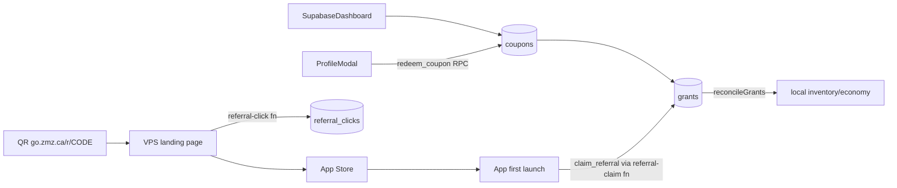

# Zikaron3D ג€” Plan v2 (Animated Arcade Platform)

## 1. Vision
A high-end, console-quality arcade game platform. Opening the app should feel like turning on a Nintendo Switch / PS5: a living animated hub, characters with personality, motion and effects everywhere. Sleek, premium, appealing to all ages (kids, gamers, seniors).

- **No cards.** No flat tile grids. Gameplay is driven by animated characters, moving objects, light, sound and haptics.
- **No text in gameplay.** Icons, color, motion, sound pitch and haptics only.
- **Nothing static.** Every object idles, breathes, reacts to touch.
- **Multi-genre.** Memory is one pillar; the platform also hosts reflex, puzzle and rhythm games, all sharing one cast of characters and one effects engine.

## 2. What changes from v1
- **Drop:** card grid, card flips, metallic card vaults, single-genre memory board.
- **Keep:** `SeededRNG`, `DDAEngine` (skill rating + mercy, generalized to all games), zustand + MMKV, haptics, the 3 modes, monetization / parental gate / Supabase services, PixVerse as the asset source (now via CLI).

## 3. Player experience

### 3.1 Boot sequence (ג‰ˆ3s, skippable)
Logo forms from particles, light sweep, sound sting, haptic pulse, zoom into the hub.

### 3.2 Console Hub
- Carousel of game "worlds" as glowing animated portals (looping cinematic video inside each); swipe to rotate, tap to dive in with a zoom/warp transition.
- Gyroscope parallax on layered backgrounds (`expo-sensors`), ambient particles, light rays.
- Mascot character idles, waves, reacts to taps, celebrates wins.
- Top bar: avatar, XP ring, collection, settings (icons only).

### 3.3 Game catalog (one cast, many genres)
| Game | Genre | Mechanic |
|---|---|---|
| **Critter Burrows** (MVP) | Memory | Creatures pop out of burrows, dance, hide. Tap two burrows to find matching creatures; matches celebrate and fly into your collection. |
| **Orb Merge** (MVP) | Physics puzzle | Drop creature-orbs into a glass bowl; identical ones merge into bigger, more elaborate creatures with bursts and chain reactions. |
| **Star Catcher** (MVP) | Reflex | Swipe a character to catch falling stars and dodge hazards; speed and patterns scale with skill. |
| Echo Orbs | Memory | Orb-creatures play a light + sound + dance sequence; repeat it. |
| **Shell Shuffle** (World 4) | Attention | Coral hides pearls in clams that shuffle in arcs; track them. |
| **Vine Flow** (World 5) | Spatial logic | Rotate vine tiles so glowing sap runs from the spring to every bud; buds bloom as sap arrives. |
| **Beat Circuit** (World 6) | Rhythm | Hit glowing pulses on circuit lanes as they reach the pads; every hit plays the next note of the melody. |
| **Echo Peaks** (World 7) | Working memory | Stars land on a ring of peaks while tones ring; tap when the peak, tone or colour matches the one from N steps back (dual n-back). |

### 3.4 Juice layer (shared engine, applied everywhere)
Squash & stretch, anticipation and overshoot springs, particle bursts, glow/bloom, screen shake, slow-motion on combos, confetti, camera punch-in, pitch-rising combo sounds, haptic patterns per event.

### 3.5 Meta
Animated creature collection, XP and level ring, daily challenge, world unlocks, cross-game progression.

## 4. Modes
- **TOYBOX (kids):** no timers, slower motion, bigger targets, hints, max celebration.
- **ARCADE (gamers):** timers, fever combos, streak shield, leaderboards, ghost PvP later.
- **SANCTUARY (seniors / zen):** untimed, calm music, high contrast, reduced shake/flash, larger targets.

## 5. Visual direction
- Stylized premium toy look (Astro Bot / Nintendo first-party level): rounded glossy characters, rim lighting, deep gradient skies, glow.
- One consistent art bible: palette, lighting, character proportions, locked prompt templates + reference images so every PixVerse output matches.
- UI: dark glass console panels, large icon buttons, spring transitions.
- Target 60fps on iPhone 12 or newer.

## 6. Asset pipeline (PixVerse CLI)
PixVerse produces images, video, music and sound ג€” not 3D models. Characters are rendered as high-quality animated sprites in a 2.5D engine.

1. **Character masters:** `pixverse create image --background transparent` ג†’ one master PNG per character, reused as the reference image for all later generations (consistency).
2. **Animation clips:** `pixverse create video --image <master>` on a flat chroma background, 1:1, 2ג€“5s, per action: `idle`, `pop`, `hide`, `celebrate`, `sad`, `merge`. Use `transition` mode (same first/last frame) for seamless loops.
3. **Processing (`scripts/assets/`):** ffmpeg chroma key ג†’ transparent frames ג†’ packed sprite atlas (WebP) + JSON at 12fps. All characters share a 256ֳ—320 logical frame (one crop, consistent cast scale); each clip atlas is trimmed to its own content and records its cell rect (`x, y, w, h`) in that frame, packed for the smallest texture ג‰₪4096px.
4. **Worlds:** one still per world + shader motion (mist, rays, parallax). No video backgrounds (PixVerse world video invents creatures and ignores locked camera).
5. **Audio:** `pixverse create music` per world, sound effects for every event.
6. **Manifest:** `scripts/assets/buildRegistry.py` generates `src/render/castRegistry.ts` (static `require`s + clip metadata) from `assets/sprites/*/manifest.json`; the app loads characters only through it.
7. Budget: credits per character ג‰ˆ 1 image + 6 clips; MVP cast = 8 characters + mascot.

## 7. Tech stack
- **Renderer:** `@shopify/react-native-skia` for the 2.5D game scenes (sprite atlases, video textures, shaders for glow/dissolve/ripple, particle systems) + `react-native-reanimated` for 60fps UI-thread animation.
- **Physics (Orb Merge):** own circle physics (`src/engine/physics.ts`) on a 120Hz fixed timestep.
- **Gestures:** `react-native-gesture-handler`.
- **Audio:** `expo-audio`. **Haptics:** `expo-haptics`. **State:** zustand + MMKV. **Routing:** Expo Router.
- **Dropped:** `@react-three/fiber`, `three`, `expo-gl`, `@react-three/drei` (no 3D model source; Skia gives a better look/perf ratio for sprite art).
- Verify every package against Expo SDK 58 docs before installing.

## 8. Folder structure
```
src/app/                 routes: index (hub), game/[id], collection, settings
src/engine/              SeededRNG, DDAEngine, types, loop (fixed timestep), physics
src/render/              Skia scene, Sprite, Atlas loader, Particles, Shaders, CameraRig
src/fx/                  springs, shake, bursts, slow-mo, sfx + haptic maps
src/games/<id>/          rules + scene per game
src/ui/                  console HUD, hub carousel, icon buttons
src/store/               zustand stores
scripts/assets/          PixVerse generation, chroma key, atlas packing, manifest
assets/sprites | worlds | audio
```

## 9. Phases
0. **Look prototype (approve before gameplay):** generate 1 character (6 clips) + 1 world via CLI, run the pipeline, show it in a Skia scene with particles, glow, parallax and tap reactions. Deliver a screen recording.
   - *Status: done, look approved.* Pip (6 clips) + Meadow world + music + SFX in `src/scenes/MeadowPrototype.tsx`.
   - *Learned:* PixVerse video ignores "locked camera" for wide scenes and invents extra creatures, so worlds use a still image + shader motion (mist, stars, rays, camera breathe). Character clips on chroma green work well; avoid words like "tapped" (it draws hands). CLI allows ~3 concurrent jobs.
   - *Resolved:* atlases are trimmed per clip (see Phase 1) and decoded lazily per clip.
1. **Asset pipeline at scale:** art bible, prompt templates, full MVP cast + mascot + 3 worlds + audio.
   - *Status: done, cast look approved.* Cleanup done (v1 code moved to `archive/v1-cards`, rules rewritten).
   - *Cast (9):* Pip (orange, mascot), Bloop (blue drop), Fuzz (pink puffball), Nutty (brown acorn), Zap (yellow), Grumble (purple pebble), Frost (icy white-cyan), Ember (red flame tuft), Dusk (indigo moon). Each has distinct colour AND silhouette (accessibility). Clips: idle, pop, celebrate, sad (Pip also hop, wave, surprised). Listed in `scripts/assets/cast.tsv`.
   - *Worlds (3):* Meadow, Crystal Cavern, Candy Sky ג€” still + music each (`assets/worlds/*`, `assets/audio/music/*`).
   - *Art bible:* glossy vinyl-toy 3D look (Astro Bot / Nintendo first-party), big glossy eyes with catchlights, cream belly, rim light, no text. Masters use Pip as the style reference and are generated on flat chroma green (the "transparent background" mode leaves a dark aura that becomes a dark outline in video). Prompt text lives in `scripts/assets/generateCast.sh`.
   - *Pipeline:* `generateCast.sh [masters|clips|all] [names]` ג†’ `.venv-assets/bin/python buildSprites.py <name> --max 320` ג†’ `buildRegistry.py` (writes `src/render/castRegistry.ts`). Matte = adaptive green-dominance key (border-sampled background) + dark-rim removal; characters must not be green. Python needs `.venv-assets` (numpy).
   - *Learned:* image prompt words like "zigzag"/"lightning" can trip PixVerse filters (status 17); the generated green drifts per clip; the CLI occasionally fails with network errors, re-run (idempotent).
   - *Asset pass done (Oct 2026):* atlases trimmed per clip ג€” all clips 744MB ג†’ 406MB decoded, idle set 189MB ג†’ 79MB (idle ג‰ˆ7ג€“10MB each). Clips may extend past the shared crop, so wide poses (Dusk tail, Grumble/Zap jumps) are no longer cut. Camera push-in clips regenerated with a stronger no-zoom prompt: Fuzz sad/pop/celebrate and Dusk sad (rejects in `assets/raw/_rejected/zoom/`). Every clip now stays within ~1.15ֳ— scale of its first frame except Fuzz pop/celebrate (~1.3ֳ—, in frame, best of three takes). `expo-video` removed (worlds are stills). Renderers (`SpriteCharacter`, Orb Merge `TierAtlas`) read the per-clip cell rect.
   - *Rebuild a character:* `.venv-assets/bin/python scripts/assets/buildSprites.py <name>` then `.venv-assets/bin/python scripts/assets/buildRegistry.py`.
2. **Hub:** boot sequence, portal carousel, mascot, navigation.
   - *Status: built, awaiting your review.* `src/scenes/Hub.tsx` (+ `src/worlds.ts`, `src/render/hubDraw.ts`): particle-formed star logo with flash, sound and haptic; swipeable 3-portal carousel (spring snap, rubber-band, parallax windows, animated rim, resident peeking out); Pip mascot reacting to swipes/taps; icon-only HUD (profile + XP ring, collection, settings placeholders); tap portal/play button dives in with a warp + white-out; per-world music crossfade. Later returns to the hub skip the logo. World stages are placeholders (Meadow = Pip scene, Crystal/Candy = cast showcase) until Phase 3.
   - *Deviation:* navigation is a plain scene switch in `App.tsx`, not Expo Router (it needs new native modules = rebuild). Migrate with the next native rebuild.
   - *Open:* verify swipe feel on a real device. (HUD buttons now wired in Phases 4-5.)
3. **MVP games:** Critter Burrows, Orb Merge, Star Catcher ג€” full loops with juice, modes, DDA.
   - *Status: Critter Burrows built, awaiting your review (Meadow portal now opens it).* `src/games/burrows/` (`CritterBurrows.tsx`, `Burrow.tsx`, `logic.ts`) + shared `src/engine/{SeededRNG,dda}.ts`, `src/fx/useJuice.ts`, `src/store/profile.ts` (zustand + MMKV: mode, level). Flow: creatures rise out of burrows (preview) ג†’ hide ג†’ tap two to match; match = celebrate + chime pitch rising with combo, miss = droop + shake, round clear = confetti and next round. DDA (`SkillTracker`) scales pair count (3ג€“6), preview and hide time; mercy hints peek the partner. Modes via top-right icon (cycles Toybox/Arcade/Sanctuary): Toybox untimed + idle hints, Arcade timer bar + combo pips, Sanctuary slow and low shake.
   - *Memory:* only the idle atlas of the round's species is decoded; celebrate loads when a species is first revealed.
   - *Status: Orb Merge built, awaiting your review (Crystal portal opens it).* `src/games/orbs/` (`OrbMerge.tsx`, `logic.ts`) + `src/engine/physics.ts` (own circle physics, position-based, 120Hz fixed step, unit-checked in Node; replaces `matter-js`) + shared `src/render/WorldBackdrop.tsx`, `src/ui/ModeIcon.tsx`, `src/render/castColors.ts`. Drag to aim, release to drop; two identical creatures merge up the ladder Bloop ג†’ Fuzz ג†’ Nutty ג†’ Zap ג†’ Grumble ג†’ Frost ג†’ Ember ג†’ Dusk ג†’ Pip (HUD ladder fills as tiers are reached). Sim runs on the JS thread and mirrors a snapshot to the UI thread (one Atlas per tier). Chain merges raise chime pitch. Arcade: creatures above the line for 2.4s = game over (restart). Toybox/Sanctuary: nothing ends, bubbles burst to make room; DDA mercy often serves a tier already in play. Tiers decode lazily (up to two above the highest reached).
   - *Status: Star Catcher built, awaiting your review (Candy portal opens it).* `src/games/stars/` (`sim.ts` Node-tested with a bot in all 3 modes, `draw.ts`, `StarCatcher.tsx`). Drag to slide a random Candy resident (Zap/Nutty/Ember) under falling stars; gold stars score triple and trigger celebrate; 8 in a row = fever (magnet, slow-mo punch-in, glow, faster spawns). Patterns: lines, arcs, stairs, hazard walls (spiky faces) with a guaranteed gap. Arcade: 3 hearts, misses break streak, hazards cost a heart. Toybox: bigger stars, hazards only bump. Sanctuary: no hazards, no fever, slower. Skill rating drives difficulty; a struggling player gets a gold star dropped above them. HUD: fever meter + hearts + mode icon.
   - *Phase 3 complete.* *Open:* tune feel on device (spawn rates, speeds, drag smoothing); Burrows/Orbs/Stars each need a real-device pass; hub residents/portals still map 1 world = 1 game.
4. **Meta + sound pass:** collection, XP, daily challenge.
   - *Status: progression, collection, and daily challenge built, awaiting your review.* `src/store/profile.ts` persists XP, creature discoveries, game bests, mode, and daily completions in MMKV. `src/store/progression.ts` derives the icon-only hub XP ring. Every game now awards XP and unlocks its creatures: matched burrows unlock residents, merge tiers unlock evolution creatures, and Star Catcher unlocks its current Candy resident. The hub collection-star opens `src/scenes/Collection.tsx`: a three-page animated toy shelf, discovered-creature gems, locked silhouettes, and tap sparkle reactions. Hub gear cycles modes. The avatar ring starts today's deterministic challenge (`src/engine/daily.ts`): its world, game seed, and Star Catcher hero are identical across devices for the UTC day. Daily rewards only apply in this route: clear Burrows, merge tier 4 in Orbs, or enter Fever in Stars. The avatar XP ring turns mint after completion.
   - *Open:* Collection decodes at most 3 idles per page (ג‰ˆ30MB).
5. **Polish + ship:** performance, accessibility, parental gate, store compliance.
   - *Status: settings + accessibility pass built, awaiting your review.* `src/store/audioSettings.ts` (MMKV: music, SFX, reduce motion). `src/scenes/Settings.tsx` (icon-only toggles; hub gear **long-press**). `src/fx/sound.ts` honors mute + music ducking; `src/fx/useJuice.ts` scales shake/flash via `motionScale()`. `src/ui/ParentalGate.tsx` + `useParentalModeCycle` on hub and all three games (Toybox ג†’ Arcade only).
   - *Status: Collection perf + commerce guard.* Shelf uses `ownedSet`, fewer fireflies / static idle sprites when reduce motion is on; UI chrome is `useMemo` not a worklet. `src/store/compliance.ts` + `useParentalCommerceGate` gate Settings restore; passing the Arcade gate also opens a 10ג€‘min commerce session. `src/services/monetization.ts` configures RevenueCat when `EXPO_PUBLIC_REVENUECAT_*` keys are set.
   - *Status: unlocks, shield, leaderboard, cloud (built, untested on device).*
     - *World unlocks:* Meadow always open, Crystal at level 3, Candy at level 5 (`src/worlds.ts`); locked portals show a padlock and a sad bump; unlock celebration once per world (`celebratedWorlds`). Daily route bypasses locks.
     - *Streak shield:* one per Arcade run in Star Catcher and Burrows; absorbs a hazard hit, a miss at streak >= 3, or a mismatch at combo >= 2. Inventory starts 3, cap 30, +1 per daily; consumable IAP `shield_pack_10` (+10, parental-gated; direct grant in `__DEV__` without store keys).
     - *Leaderboard:* weekly score = Arcade XP this ISO UTC week, all games (`src/scenes/Leaderboard.tsx`, `src/services/leaderboard.ts`; hub cup icon). Icon-only; top 10 + own row.
     - *Cloud:* Supabase + Sign in with Apple (`src/services/{supabase,sync}.ts`, `supabase/schema.sql`). Sync merge: max for numbers, union for sets; debounced push. Settings has sign-out and in-app account deletion (`delete_my_account()` RPC, guideline 5.1.1(v)). Client is disabled when env keys are missing/placeholder.
     - *Needs you:* run `supabase/schema.sql`; set real `EXPO_PUBLIC_SUPABASE_URL`/`ANON_KEY` in `.env` (currently placeholders); enable Apple provider in Supabase; create `shield_pack_10` in App Store Connect + RevenueCat; native rebuild (`expo-apple-authentication`). Kids-category + Sign in with Apple needs COPPA review.
   - *Compliance & Store Readiness (implemented):*
     - Real IAP via RevenueCat (crystals_100/500/1200, starter_pack one-time special with 3 rare skins, shield_pack_10). Store prices, parental gate on every purchase, restore purchases button in Shop and Settings. `identifyPurchaser` ties StoreKit receipts to the Supabase user and `reconcilePurchases` re-grants ledger rows on a new device (`src/services/monetization.ts`, wired in `src/services/sync.ts`). Promo codes removed; promotions use Apple Offer Codes.
     - Legal & COPPA links in Settings and Shop (privacy.html, terms.html, support.html).
     - Hardened Supabase schema with CHECK constraints, rate-limit triggers, and purchases ledger with RLS.
     - Edge Functions: `revenuecat-webhook` (shared-secret auth, idempotent ledger upsert), `link-apple` (stores the Apple refresh token right after sign-in) and `delete-account` (revokes every stored Apple token, then deletes the user). JWT verification is pinned per function in `supabase/config.toml`.
     - Encrypted MMKV auth storage (secureKv.ts via Keychain).
     - App Store Connect submission checklist and privacy nutrition labels (APP_STORE_CONNECT_CHECKLIST.md).
     - Parental gate removed in 2.15.1 (owner decision): no math prompt anywhere; shop, purchases, mode switch, world unlocks and legal links act immediately. App ships in Games > Casual 4+, not the Kids category. TOYBOX still hides the currency bar mid-level. Shop/Settings show a "store unavailable / purchase failed" message instead of failing silently.
     - Store config: Local Network/Bonjour keys only in the development variant (`app.config.ts`), `ITSAppUsesNonExemptEncryption: false`, privacy manifest reasons (UserDefaults, file timestamp, boot time, disk space), `eas.json` profiles, console stripping in release builds (`babel.config.js`).
     - Public site: **live at `https://zmz.ca/zikaron3d/`** (privacy with the COPPA/GDPR-K section, terms, support, marketing). Files are in `public-site/` and published into the zmz.ca nginx vhost on the shared host (`/www/wwwroot/zmz.ca/zikaron3d`, Cloudflare in front) with `scripts/deploy/deploy-site.mjs`; `Caddyfile` + `harden-vps.sh` remain the path for a dedicated game VPS only.

   - *Open:* migrate to Expo Router on next native rebuild; run `node scripts/deploy/deploy-backend.mjs` + `node scripts/deploy/verify-live.mjs` (schema, secrets, Edge Functions, live RLS/anti-cheat checks) and `node scripts/deploy/deploy-site.mjs --harden` (see `scripts/deploy/README.md`); configure RevenueCat/App Store Connect per `APP_STORE_CONNECT_CHECKLIST.md` §10; then the device pass in `TESTFLIGHT_TEST_PLAN.md`.
6. **Worlds 4-7: one new game per world, rising age.**
   - *Rule:* each world owns exactly one game, no game repeats across worlds. The mapping is the `game` field in `src/worlds.ts` (`homeWorld(game)` for Level Select); `App.tsx` and `Hub.tsx` read it, and `getGameLevel`/`setGameLevel` in `src/store/profile.ts` replace per-game if-chains.
   - *Age ladder:* Worlds 1-3 ages 4-7, World 4 Deep Sea 7-9, World 5 Grove 9-11, World 6 Circuit 11-13, World 7 Summit teens/adults. Every world now has its own game.
   - *Status: Shell Shuffle built (World 4, Deep Sea), awaiting your device review.* `src/games/shells/` (`logic.ts` pure + Node bot-checked: 405k rounds over 1,000 seeds x 30 levels x 3 modes, the tracking bot always wins, no pair twice in a row, no round equal to the previous one; `draw.ts`; `ShellShuffle.tsx`). Coral drops pearls into glossy clams, they shut and shuffle along arcs with bubble trails, tap the right clam. 30 levels in `SHELL_LEVELS` (`src/engine/levelTables.ts`): 3 ג†’ 6 clams, 4 ג†’ 22 swaps, 700 ג†’ 220ms; every early level changes something visible (L2 faster, L3 4 clams, L4 `double`, L5 `fakeout` + pick timer, L6 5 clams), then `ink` (L8), `current` carousel (L9), `twoRows` (L12), `urchin` decoy (L14), `speed` bursts (L17), mixes after that, all at L30. Toybox caps 4 clams with no ink/urchin/two rows/speed and a hint glow after a miss; Sanctuary slow, no ink/speed; Arcade has a pick timer, 3 hearts and the streak shield. DDA nudges swap speed and count per round. Daily: 3 rounds won in a row. Achievements category `shells` (`shells_level` metric). Burrows now lives in Meadow only.
   - *Assets:* `clam` prop (idle / pop / sad) via `scripts/assets/generateNewCharacters.py` (props take a custom master prompt + clip list); the first pop take zoomed in and is in `assets/raw/_rejected/zoom/clam_pop.mp4`. Pearl, urchin and ink are drawn in Skia. Clam atlases ג‰ˆ29MB decoded.
   - *Open:* tune on device (clam size, pearl position in the bowl, swap tempo); `shellsLevel` (like Orb/Star levels) is not yet a Supabase column.
   - *Status: Vine Flow built (World 5, Grove), awaiting your device review.* `src/games/vines/` (`logic.ts` pure + Node bot-checked: 234k puzzles over 1,000 seeds x 30 levels x 3 modes; the reference solution always solves, scrambles are never pre-solved, linked pairs stay solvable, colours never cross, a fog-aware bot that only turns visible tiles always finishes within par, no puzzle equals the previous one; `draw.ts`; `VineFlow.tsx`). Puzzles are random spanning trees from the spring(s) pruned to spring-to-bud paths, then scrambled; par is the sum of minimum quarter turns (avg 7 at L1, ~30 late Arcade). Tap a tile to turn it (springy overshoot); sap glows gold (blue for the second spring), beads travel along lit vines, buds bloom when their own colour reaches them, red when colours clash. 30 levels in `VINE_LEVELS`: 4x4 ג†’ 7x7, 1 ג†’ 6 buds; L2 2 buds, L3 5x5 + `decoys`, L4 `locked` stones, L5 `thorns`, L6 5x6, L7 `moves` (leaf bar, par + slack), L8 6x6, L9 `linked` pairs, L12 `fog`, L15 `twins` (two springs, two colours), L18 `wilt` timer, L19+ 7x7, all at L30. Toybox caps 5x5 and 3 buds, drops moves/fog/twins/wilt, hint glow after 5s idle; Sanctuary drops moves/wilt; Arcade has 3 hearts and the shield (a failed puzzle resets the same board). DDA adjusts move slack, wilt time and decoy density. Daily: 2 puzzles solved. Achievements category `vines` (`vines_level`, `vines_perfect` for solving at par).
   - *Assets:* `bud` prop (idle / pop bloom / sad droop); the first pop take pushed in to a face-on flower and is in `assets/raw/_rejected/zoom/bud_pop.mp4`. Moss hosts. Tiles, vines, sap, thorns, stones, fog are drawn in Skia. Bud atlases ג‰ˆ25MB decoded.
   - *Open:* tune on device (tile size on 7x7, bud placement on its tile, wilt length); `vinesLevel` is not yet a Supabase column.
   - *Status: Beat Circuit built (World 6, Circuit), awaiting your device review.* `src/games/beats/` (`melodies.ts`, `logic.ts` pure + Node bot-checked: 180k charts over 1,000 seeds x 30 levels x 3 modes; pitches stay in range, same-lane and any-lane gaps hold, chords max 2 on different lanes, nothing inside a hold, a perfect bot scores 100%, a 60ms-late bot passes and the auto-offset converges, a bot missing 30% never fails the soft modes, all-miss Arcade drains the battery, no chart equals the previous one; `draw.ts`; `BeatCircuit.tsx`). Pulses run down 3-5 neon lanes to hex pads; each hit plays the melody's next note (taps make the sound, so audio latency never feels late), misses play a buzz and red static. Kick/hat beat bed with a 4-tick count-in; Bolt dances on the beat (new `dance` clip). 30 levels in `BEAT_LEVELS`: 80 ג†’ 150 BPM, 8 ג†’ 16 bars; L2 `eighths`, L3 4 lanes, L4 `holds`, L5 `chords`, L6 `offbeat`, L8 `echo` (Bolt plays a phrase, you answer), L10 5 lanes, L12 `ghost` pulses fade out, L14 lane `switch`, L17 `tempo` ramp, all at L30. Odd levels up to L23 are classics in difficulty order, even levels are seeded C-major-pentatonic tunes (AABA'), L24+ mixes. Toybox caps 3 lanes / 95 BPM with wide windows and no tricky mechanics; Sanctuary 0.8x tempo, no ghost/tempo; Arcade has tight windows, a battery that drains on misses, 3 hearts and the shield (refills the battery once). DDA nudges BPM, windows and eighth density. Daily: one song passed. Achievements category `beats` (`beats_level`, `beats_fullcombo`).
   - *Melody legal note:* only public-domain compositions (composer died 70+ years ago, published before 1929): Twinkle, Frֳ¨re Jacques, Ode to Joy, Brahms' Lullaby, Bach/Petzold Minuet in G, Morning Mood, Can-can, Eine kleine Nachtmusik, In the Hall of the Mountain King, Fֳ¼r Elise, William Tell, Rondo alla Turca. Every melody is our own single-line transcription of the composition (no MIDI files, arrangements or recordings taken from anywhere), played by our own synthesized notes (`scripts/assets/buildNotes.py` ג†’ `assets/audio/notes/`). No titles or composer names appear in the game. Provenance is noted per tune in `melodies.ts`.
   - *Assets:* Bolt `dance` loop (4s) via `generateNewCharacters.py`; notes/kick/hat/tick/buzz synthesized with ffmpeg (ג‰ˆ516KB); lanes, pads, pulses and battery drawn in Skia.
   - *Open:* tune on device (lane width, travel time, judge windows vs. real audio latency, note volume vs. beat bed); `beatsLevel` is not yet a Supabase column.
   - *Status: Echo Peaks built (World 7, Summit), awaiting your device review.* `src/games/peaks/` (`logic.ts` pure + Node bot-checked: 180k rounds over 1,000 seeds x 30 levels x 3 modes; target counts are exact per channel, no channel matches 3 steps in a row, target flags agree with the values, lures never count as targets, a perfect bot scores 1, never-tap and always-tap bots both score 0, a steady bot catching 80% of matches with 10% false taps passes the soft modes and never drains Arcade, no round equals the previous one; `draw.ts`; `EchoPeaks.tsx`). Luna sits inside a ring of 8 snowy peaks; each step a star falls onto a peak and a pentatonic tone rings. Icon buttons at the bottom (peak, sound waves, colour dots) mean "same as N steps back". N shows as a row of lanterns; the echo hint draws ghost stars of the last N steps with a ring on the one to compare against (and tints the lanterns by tone). Score per channel = hit rate minus false-alarm rate, averaged. 30 levels in `PEAK_LEVELS`: N 1 ג†’ 4, 3000 ג†’ 1700ms steps; L1 position, L2 sound, L3 both, L4-5 N=2, L6 faster, L7 `lures` (near-misses at Nֲ±1), L8 colour channel (third button), L10 N=3, L12 `drift` (ring rotates), L14 `flash` (star shows briefly), L16 triple N=3, L18 `tempo` (steps speed up), L20 N=4, all at L24+/L30. Toybox: one channel per level, N at most 2, hint always, slow, no mechanics; Sanctuary 1.3x step time, no tempo/flash, hint through N=2; Arcade has a focus battery (drains on misses and false taps), 3 hearts and the shield. DDA adjusts step time and gives weaker players the hint for the first steps. A retry is a fresh sequence so it can't be memorised. Daily: one round passed. Achievements category `peaks` (`peaks_level`, `peaks_n4`).
   - *Assets:* none new; Luna's idle / pop / celebrate / sad, tones from `src/fx/notes.ts`, everything else drawn in Skia.
   - *Open:* tune on device (ring size on small phones, button size, step pacing for adults vs. teens); `peaksLevel` is not yet a Supabase column.
7. **Post-launch:** Echo Orbs, ghost PvP.
8. **Coupons and QR referrals.** *Status: planned, not started.* Server-validated coupon codes (managed for free in the Supabase dashboard) and unlimited per-user QR referral codes that auto-credit both players, using Supabase (RPCs + Edge Functions), a self-hosted referral landing page on the new VPS, and a shared server grant ledger applied to the local inventory. Written so a lower-cost model can build it step by step.

### 9.8 Coupons and QR referrals - build plan

#### Decisions (locked)
- **Coupon admin**: Supabase Dashboard (free tier, already used). Table Editor = enable/disable/expire/edit; SQL Editor = bulk generate via `admin_generate_coupons(...)`. No extra install.
- **Referral**: fully automatic. QR -> `https://go.zmz.ca/r/<CODE>` landing page on deepflow-vps -> App Store. On first launch the app claims via (1) universal link, (2) server IP match, (3) iOS paste button fallback. Silent Supabase anonymous account for anyone not signed in.
- **Single reward path**: every reward (coupon or referral) is a row in a server `grants` ledger; the client applies unseen rows to local stores (same pattern as `reconcilePurchases()` in `src/services/monetization.ts`).
- Placeholder domain `go.zmz.ca` (owner creates DNS A record in Cloudflare dashboard to 77.42.114.57, DNS-only/grey cloud so Let's Encrypt + AASA work).



#### Asset types (a "game asset")
`asset_type` enum: `skin | accessory | crystals | stardust | shields`. `asset_id` = catalog id for skin/accessory (from `src/data/shopCatalog.ts` `SKIN_CATALOG`/`ACCESSORY_CATALOG`), currency name for currencies; `amount` for currencies (1 for items). Client apply map:
- skin -> `useInventory.getState().addSkin(id)`
- accessory -> `useInventory.getState().addAccessory(id)`
- crystals -> `useEconomy.getState().earnCrystals(n, false)`
- stardust -> `useEconomy.getState().earnStardust(n)`
- shields -> `useProfile.getState().addShields(n)`

#### Step 1 - Database: append to `supabase/schema.sql` (re-runnable)
Tables (all `create table if not exists`, RLS enabled):
- `game_assets(id text pk, asset_type text check in (...), name text)` - seeded from catalog; read all for `authenticated`. Coupons FK to it so the dashboard shows a picker and typos are impossible. Insert rows `('crystals','crystals'),('stardust','stardust'),('shields','shields')` for currencies.
- `coupons(code text pk check (code ~ '^[A-Z0-9]{6,16}$'), asset_id text not null references game_assets, amount int not null default 1 check (amount between 1 and 100000), active bool not null default true, starts_at timestamptz default now(), expires_at timestamptz null, max_redemptions int null, redemption_count int not null default 0, batch text, note text, created_at timestamptz default now())`. **No client policies** (clients only use the RPC).
- `coupon_redemptions(code text references coupons on delete cascade, user_id uuid references auth.users on delete cascade, created_at, primary key(code,user_id))`.
- `coupon_attempts(user_id uuid, created_at timestamptz default now())` + index - failed-attempt throttle.
- `referral_codes(code text pk, owner_id uuid references auth.users on delete cascade, created_at, disabled bool default false)` + index on owner_id. Policy: select own.
- `referral_clicks(id bigserial pk, code text references referral_codes on delete cascade, ip_hash text, platform text, created_at, claimed_by uuid null)`. No client policies.
- `referrals(referee_id uuid pk references auth.users on delete cascade, referrer_id uuid references auth.users on delete cascade, code text, created_at)` - pk on referee = a user can be referred only once. Policy: select where `referrer_id = auth.uid() or referee_id = auth.uid()`.
- `reward_config(key text pk, asset_id text references game_assets, amount int)` - rows `referral_referrer`, `referral_referee` (editable in dashboard). Seed e.g. referrer = `crystals` 50, referee = a common skin.
- `grants(id bigserial pk, user_id uuid references auth.users on delete cascade, source text check in ('coupon','referral_referrer','referral_referee'), source_ref text, asset_type text, asset_id text, amount int, created_at)`, unique `(user_id, source, source_ref)`. Policy: select own.

Functions (all `security definer`, `set search_path = public`, `revoke all from public, anon; grant execute to authenticated` except admin ones which get **no** grants -> only dashboard/service role):
- `redeem_coupon(p_code text) returns json`:
  1. `auth.uid()` required; normalize `upper(trim(p_code))`.
  2. If >=10 rows in `coupon_attempts` for user in last hour -> `{ok:false, reason:'throttled'}`.
  3. `select ... for update` the coupon. Fail reasons: `not_found`, `inactive`, `not_started`, `expired` (`expires_at <= now()`), `used_up` (`max_redemptions` reached), `already_redeemed`. On fail insert into `coupon_attempts` and return reason.
  4. Insert `coupon_redemptions`, increment `redemption_count`, insert `grants(source='coupon', source_ref=code, ...)` joined with `game_assets` for `asset_type`.
  5. Return `{ok:true, asset_type, asset_id, amount}`.
- `admin_generate_coupons(p_asset_id text, p_count int, p_amount int default 1, p_expires_at timestamptz default null, p_max_redemptions int default 1, p_batch text default null, p_prefix text default '') returns setof text` - random codes from alphabet `ABCDEFGHJKLMNPQRSTUVWXYZ23456789` (no 0/O/1/I), length 8 after prefix, retry on conflict. Also `admin_set_batch_active(p_batch text, p_active bool)` and `admin_expire_batch(p_batch text)`.
- `create_referral_code() returns text` - 7-char code same alphabet, insert for `auth.uid()`, unlimited per user. Rate guard: max 50 per user per day (anti-spam only).
- `claim_referral(p_code text, p_referee uuid) returns json` - **not granted to authenticated**; called only by the Edge Function with service role. Checks: code exists and not disabled; owner != referee; referee has no `referrals` row; referee `auth.users.created_at > now() - interval '48 hours'`. Insert `referrals`, insert two `grants` rows (`referral_referee` source_ref=referrer id, `referral_referrer` source_ref=referee id) using `reward_config`. Returns `{ok, reason?}`.
- `delete_my_account` needs no change (cascades cover new tables).

#### Step 2 - Seed script for `game_assets`
New `scripts/admin/genAssetSeed.ts` (run with `npx tsx`): imports `SKIN_CATALOG`, `ACCESSORY_CATALOG`, writes `insert into game_assets ... on conflict (id) do update set name = excluded.name;` to `supabase/seed_assets.sql`. Re-run whenever the catalog changes; paste into SQL Editor.

#### Step 3 - Edge Functions (`supabase/functions/`, mirror style of `revenuecat-webhook/index.ts`)
- `referral-click` (`verify_jwt = false`): POST `{code, platform}` from the landing page. Validate code regex `^[A-Z2-9]{7}$` and existence; hash client IP (`x-forwarded-for` first entry) as `sha256(ip + REFERRAL_IP_SALT)`; insert `referral_clicks`; delete clicks older than 7 days. CORS allow `https://go.zmz.ca` only. Return 204.
- `referral-claim` (`verify_jwt = true`): body `{code?: string}`. Resolve user from JWT (`supabase.auth.getUser(token)`). If `code` missing: find most recent unclaimed `referral_clicks` with same `ip_hash` within 2 hours; if none -> `{ok:false, reason:'no_match'}`. Call `claim_referral` via service-role client; mark click `claimed_by`. Return result.
- Add both to `supabase/config.toml` with comments; secret `REFERRAL_IP_SALT` via `supabase secrets set`.

#### Step 4 - Client: auth + grants service
- Enable **Anonymous sign-ins** in Supabase Dashboard > Authentication > Providers (manual step).
- `src/services/supabase.ts`: add `ensureSession(): Promise<string | null>` - returns current `userId` or calls `supabase.auth.signInAnonymously()`. Verify the API in installed `@supabase/supabase-js` typings before use. In `signInWithApple`, if current user `is_anonymous`, try `supabase.auth.linkIdentity` with the Apple id token if the installed version supports id-token linking; otherwise keep current behavior (local inventory already holds granted items).
- New `src/services/grants.ts`:
  - `reconcileGrants(): Promise<GrantRow[]>` - select own `grants`, skip ids in MMKV set `zikaron3d-grants:applied`, apply via the map above, remember id, return newly applied rows (for celebration UI).
  - `redeemCoupon(code): Promise<RedeemResult>` - `ensureSession()`, `supabase.rpc('redeem_coupon', {p_code})`, then `reconcileGrants()`.
  - Call `reconcileGrants()` inside `syncUser` in `src/services/sync.ts` after `reconcilePurchases()`, and on app foreground (AppState `active`) so referrers get credited when the friend joins.
- New `src/services/referral.ts`:
  - `createReferralCode()` -> `ensureSession()` + RPC; `listMyReferralCodes()`; `myReferralCount()` (count `referrals` where referrer = me).
  - `referralUrl(code)` = `${process.env.EXPO_PUBLIC_REFERRAL_HOST ?? 'https://go.zmz.ca'}/r/${code}`.
  - `tryClaimOnFirstLaunch()` - runs once (flag in Keychain via `expo-secure-store` key `zikaron3d.referral.done`, survives reinstall = anti-abuse): (1) initial URL from `expo-linking` matching `/r/([A-Z2-9]{7})`; (2) else call `referral-claim` with no code (IP match). On `ok` or definitive reason (`already_referred`, `self`, `too_old`) set the flag. On `no_match` set `pendingPaste` state for the fallback UI (only within first 2 launches).
  - Also handle URLs while running (`Linking.addEventListener('url')`): if not yet claimed, claim with that code.

#### Step 5 - Native config + packages
- `npx expo install expo-linking expo-clipboard react-native-qrcode-svg` (qrcode-svg is pure JS on the already-installed `react-native-svg`). Verify each against SDK 58 docs.
- `app.json`: add `"scheme": "zikaron3d"`, `ios.associatedDomains: ["applinks:go.zmz.ca"]`. Rebuild native (`npx expo run:ios`); never edit `ios/` by hand. Ensure Associated Domains capability exists on the App ID in the Apple Developer portal.
- `.env`: `EXPO_PUBLIC_REFERRAL_HOST=https://go.zmz.ca`, `EXPO_PUBLIC_APP_STORE_URL=https://apps.apple.com/app/id<APP_ID>`.

#### Step 6 - UI
- `src/ui/ProfileModal.tsx`: add a "GIFTS" section below the wardrobe with two big buttons: **Redeem code** and **Invite friends** (lucide `Gift`, `QrCode` icons, existing sfx/haptics patterns).
- New `src/ui/RedeemCodeModal.tsx`: single `TextInput` (autoCapitalize characters, max 16, strips spaces), submit button with loading state. Map reasons to short friendly messages. On success show reward reveal (asset image from `src/data/shopAssets.ts` `getSkinImage`/`ACCESSORY_ASSETS`, or crystal/stardust/shield icon) with `sfx.play('chime')` + `sfx.play('sparkle')` + success haptic and an "Equip" shortcut for items.
- New `src/ui/InviteModal.tsx`: on open, if user has no code call `createReferralCode()`; render `<QRCode value={referralUrl(code)} size={220} />` on white rounded backing, "New code" button (creates another, unlimited), "Share" button using RN `Share.share({ message, url })`, friends-joined counter from `myReferralCount()`, and the reward preview from `reward_config`.
- New `src/ui/FriendGiftBubble.tsx` (shown from `App.tsx` when `pendingPaste`): "Got a gift link from a friend?" + `ClipboardPasteButton` from `expo-clipboard` (iOS 16+, no paste permission prompt); parse `/r/CODE` or bare code, call claim; dismissible, never shown again after dismiss.
- `App.tsx`: on mount after `initAuth()`, call `tryClaimOnFirstLaunch()`; when grants are newly applied, show the same reward reveal.

#### Step 7 - VPS landing page (deepflow-vps, `ssh deepflow-vps`)
Files in repo under new `public-site/referral/`:
- `index.html` - served for `/r/*`: kid-friendly page (logo, mascot, "Your friend sent you a gift!"), big "Get Zikaron3D" button. JS: parse code from path; on load `fetch(SUPABASE_URL/functions/v1/referral-click, {code, platform})`; on button tap `navigator.clipboard.writeText(location.href)` (user gesture) then `location.href = APP_STORE_URL`. Android/desktop: show App Store link + QR only.
- `.well-known/apple-app-site-association` (no extension, `Content-Type: application/json`):
  `{"applinks":{"details":[{"appIDs":["DAVRE4G59N.com.AdvBig.Zikaron3D"],"components":[{"/":"/r/*"}]}]}}`
- `nginx-go.zmz.ca.conf` - server block: root `/var/www/zikaron3d-go`, `location ^~ /r/ { try_files /index.html =404; }`, AASA location with JSON content type, security headers as in `public-site/Caddyfile`.
- Deploy: back up `/etc/nginx` first, copy conf to `/etc/nginx/sites-available/` + symlink, `sudo nginx -t`, reload, `certbot --nginx -d go.zmz.ca`. Do not touch outagepulse/k3s configs. Add `scripts/deploy/deploy-referral.sh` (rsync to `deepflow-vps:/var/www/zikaron3d-go`).

#### Step 8 - Admin how-to (Supabase SQL Editor / Table Editor)
- Generate: `select * from admin_generate_coupons('pip_chrome', 100, 1, '2027-01-31', 1, 'xmas26', 'XMAS');`
- Disable/enable: Table Editor > `coupons` > toggle `active`, or `select admin_set_batch_active('xmas26', false);`
- Expire: edit `expires_at`, or `select admin_expire_batch('xmas26');`
- Single public code (many users): `max_redemptions = null`.
- Stats: `select batch, count(*), sum(redemption_count) from coupons group by batch;`
- Change referral rewards: edit `reward_config`.
- Manual setup checklist: enable anonymous sign-ins, DNS `go.zmz.ca`, Associated Domains capability, function deploys + `REFERRAL_IP_SALT` secret.

#### Step 9 - Compliance
- Update `public-site/privacy.html`: anonymous account id, hashed IP for referral attribution (deleted after 7 days), no personal data in QR.
- App Store 3.1.1 risk: codes must be **free giveaways only**, never sold; all coupon assets must also be obtainable in-app.

#### Step 10 - Verification
- SQL tests in SQL Editor: redeem valid / inactive / expired / used_up / twice / throttled; claim self-referral / second referral / old account.
- Simulator: redeem flow end-to-end, QR renders and scans to correct URL, universal link opens app with code (`xcrun simctl openurl booted https://go.zmz.ca/r/ABCDEFG`), referrer sees grant after foreground.
- `curl -sI https://go.zmz.ca/.well-known/apple-app-site-association` -> 200 JSON.
- `npx expo lint` and `npx tsc --noEmit` pass.

## 10. Cleanup
- Done: v1 card code, `scripts/generatePixVerse.ts`, `assets/cards/` moved to `archive/v1-cards/` (reuse `SeededRNG`/`DDAEngine` by copying in Phase 3). Rules files rewritten.
- Done: removed `three`, `@react-three/*`, `expo-gl`, and `@types/three`; `expo-asset` was added as the required `expo-audio` peer. Pods were regenerated and Expo Doctor reports 20/20 checks passed.
- Done: removed `expo-video`; v1 `optimizeAssetsFFmpeg.sh` moved to `archive/v1-cards/scripts/`; `.env` and `__pycache__/` git-ignored.
